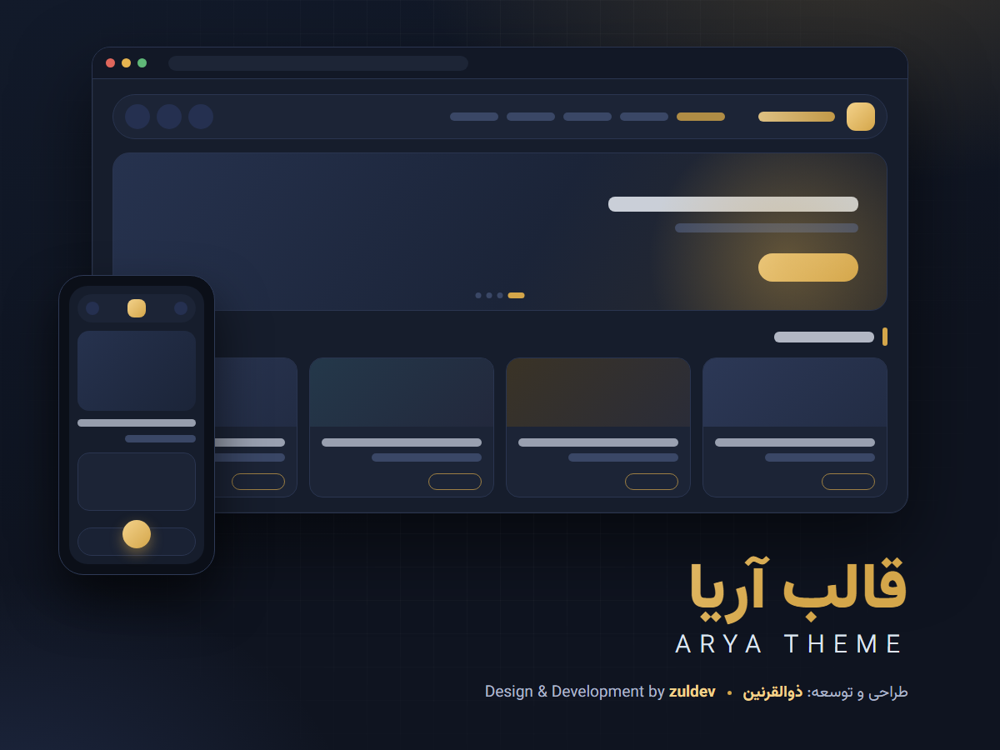

# قالب آریا · Arya Theme

**قالب مدرن، زیبا و همه‌منظوره وردپرس – راست‌چین و فارسی**
A modern, multipurpose, fully customizable RTL WordPress theme.

[**دانلود آخرین نسخه / Download latest**](../../releases/latest/download/arya_them.zip) ·
[همه نسخه‌ها / All releases](../../releases) ·
[تغییرات / Changelog](CHANGELOG.md)

---

## نصب / Install

1. فایل **`arya_them.zip`** را از [آخرین نسخه](../../releases/latest) دانلود کنید.
2. پیشخوان وردپرس › نمایش › پوسته‌ها › افزودن › بارگذاری پوسته.
3. قالب را فعال کنید و از «نمایش › سفارشی‌سازی › تنظیمات قالب آریا» تنظیم کنید.

> نام پوشه قالب باید `arya_them` بماند. · The theme folder name must stay `arya_them`.

## به‌روزرسانی خودکار / Automatic updates

قالب خودش این مخزن را بررسی می‌کند. وقتی نسخه تازه‌ای منتشر شود، در «نمایش › پوسته‌ها» کادر **«به‌روزرسانی قالب آریا»** نسخه تازه را نشان می‌دهد و با دکمه **«به‌روزرسانی از منبع»** نصب می‌شود. نیازی به توکن یا تنظیم دیگری نیست. فایل دانلودشده با کد **SHA-256** ثبت‌شده در `latest.json` تطبیق داده می‌شود.

The theme checks this repository itself. When a new version is published, the **Appearance › Themes** box shows it and installs it with one click – no token or extra setup. Every download is verified against the SHA-256 listed in `latest.json`.

## امکانات / Features

- پنج طرح هدر، سه طرح فوتر، اسلایدر مطالب، بخش ویدیو با کانال یوتیوب، جستجوی زنده
- هفت فونت فارسی داخل قالب (با نستعلیق)، تنظیم کامل لوگو و نام برند، جای‌گذاری دقیق دکمه‌ها
- حالت تیره، بهینه برای موبایل، سازگار با ووکامرس
- 5 header layouts, 3 footers, post sliders, YouTube-channel video section, live search
- 7 bundled Persian fonts, full logo & brand controls, precise placement of header buttons
- Dark mode, mobile-first, WooCommerce ready

| | |
|---|---|
| وردپرس / WordPress | 5.9 – 7.1 |
| PHP | 7.4 – 8.5 |
| مجوز / License | GPL-2.0-or-later |

طراحی و توسعه: **zuldev** · Design & development by **zuldev**
